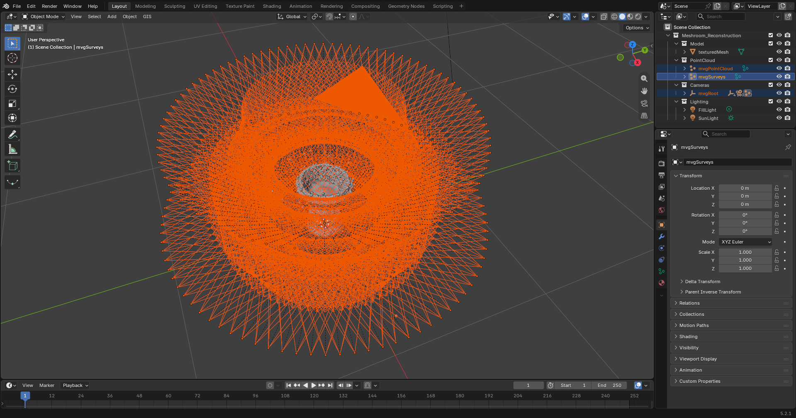
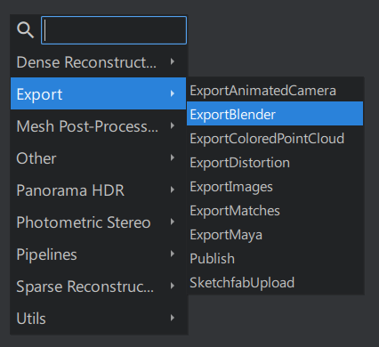
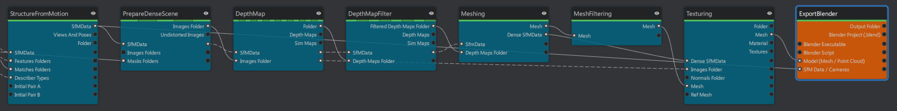

# ExportBlender Plugin for Meshroom

[](https://alicevision.org/#meshroom)
[](https://www.blender.org/)
[](LICENSE)
[](https://www.python.org/)

**[English](README.md) | [Bahasa Indonesia](README_ID.md)**

A custom pipeline node for **Meshroom (AliceVision)** that seamlessly automates the export of complete 3D photogrammetry reconstructions (textured meshes, PBR materials, SfM camera poses, and sparse point clouds) into a standalone, portable native **Blender project file (`.blend`)** with a single click.

<p align="center">
  
</p>

---

## 🚀 Key Features

* **Single-Click Native `.blend` Generation**: Assembles geometry (`.obj`, `.ply`, `.abc`), textures, camera poses, and point clouds directly into a native Blender file.
* **Auto Texture Packing (`packTextures=True`)**: Automatically packs external diffuse and normal maps directly into the `.blend` file using Blender's internal operator (`bpy.ops.file.pack_all()`), producing a 100% self-contained and portable project file.
* **Precise Spatial Alignment & Zero-Residual Camera Mapping**:
  * Correctly transforms raw AliceVision coordinates (OpenCV $+Y$-down) into Blender's native $+Z$-up coordinate space (`forward_axis='NEGATIVE_Z', up_axis='Y'`).
  * Applies rotation transforms (`transform_apply(rotation=True)`) so exported meshes have clean transforms (`Rotation: (0°, 0°, 0°)`).
  * Converts camera poses and intrinsics from AliceVision SfM (`.sfm` / JSON or `.abc`) to Blender camera objects with zero geometric deviation.
* **Asynchronous Non-Blocking GUI Launch (`openInBlender=True`)**: Automatically launches the Blender GUI showing the generated `.blend` file as an independent detached background process (`DETACHED_PROCESS` on Windows, `start_new_session` with isolated stdio on POSIX), allowing the Meshroom node to complete immediately with `SUCCESS` status.
* **Intelligent Executable Auto-Detection**: Dynamically locates the latest Blender executable on the host system across system `PATH`, standard Windows directories, Linux distributions (including **Flatpak** and `/opt/blender*/`), and macOS Application bundles. Users can also select custom binaries directly via the Meshroom GUI file picker or the `BLENDER_BIN` environment variable.
* **Professional Scene Hierarchy**: Cleanly organizes imported assets into structured Outliner collections:
  * `Meshroom_Reconstruction/Model`
  * `Meshroom_Reconstruction/Cameras`
  * `Meshroom_Reconstruction/PointCloud`
  * `Lighting` (Key SunLight and fill lighting for immediate rendering in EEVEE and Cycles)

---

## 📦 System Compatibility

* **Meshroom**: Meshroom 2025.1.0+ (AliceVision 2025.1.0+)
* **Blender**: Blender 3.2+ up to 5.x+ (supports both modern C++ importers and legacy fallback)
* **Operating Systems**: Windows 10/11 (x64), Linux (Ubuntu, Debian, Fedora, Arch, Flatpak), macOS

---

## 📂 Plugin Structure

```text
ExportBlender/
├── assets/                             # Screenshots and visual documentation media
│   ├── Adding_ExportBlender.png
│   ├── Graph_Editor_ExportBlender.png
│   └── Result_Blender.png
├── .gitignore                          # Git ignore rules for Python bytecode and OS artifacts
├── LICENSE                             # Mozilla Public License Version 2.0 (MPL-2.0)
├── README.md                           # Documentation (English)
├── README_ID.md                        # Dokumentasi (Bahasa Indonesia)
└── meshroom/
    ├── config.json                     # Meshroom plugin configuration metadata
    └── exportBlender/
        ├── __init__.py                 # Python package initialization (v1.0.0)
        ├── ExportBlender.py            # Meshroom Node Descriptor (desc.CommandLineNode)
        └── scripts/
            └── export_to_blend.py      # Headless Blender worker script (bpy automation)
```

---

## 🛠️ Installation Guide (Official Meshroom Release)

The plugin works with official pre-built binary releases of Meshroom (`Meshroom-2025.1.0-Windows.zip` or Linux tarballs).

### Method 1: Drop-in Installation (Recommended)

Copy or extract the entire `ExportBlender` folder directly into the `plugins/` directory inside your Meshroom installation folder.

```text
Meshroom-2025.1.0-Windows/
└── Meshroom-2025.1.0/
    ├── aliceVision/
    ├── meshroom/
    ├── plugins/
    │   ├── ExportBlender/              <-- Place folder here
    │   │   ├── meshroom/
    │   │   │   ├── config.json
    │   │   │   └── exportBlender/
    │   │   │       ├── ExportBlender.py
    │   │   │       └── scripts/
    │   │   └── README.md
    │   └── mrSegmentation/
    └── Meshroom.exe
```

Launch `Meshroom.exe` (or `./Meshroom` on Linux). The **ExportBlender** node will automatically appear in the node catalog.

---

### Method 2: Via Environment Variable (`MESHROOM_PLUGINS_PATH`)

If you maintain this repository in a separate location, you can register it without moving files:

* **Windows (Command Prompt):**
  ```cmd
  set MESHROOM_PLUGINS_PATH=C:\path\to\ExportBlender;%MESHROOM_PLUGINS_PATH%
  Meshroom.exe
  ```

* **Windows (PowerShell):**
  ```powershell
  $env:MESHROOM_PLUGINS_PATH = "C:\path\to\ExportBlender;$env:MESHROOM_PLUGINS_PATH"
  .\Meshroom.exe
  ```

* **Linux (Bash):**
  ```bash
  export MESHROOM_PLUGINS_PATH=/path/to/ExportBlender:$MESHROOM_PLUGINS_PATH
  ./Meshroom
  ```

---

## 🖥️ How to Use in Meshroom GUI

1. Open Meshroom.
2. In the **Graph Editor** panel (bottom area):
   * Right-click anywhere in the canvas.
   * Search for and select **ExportBlender** (categorized under `Export`).

<p align="center">
  
</p>

3. Connect pipeline pins:
   * Connect `Texturing.outputMesh` (or `Meshing.output`) ➔ `ExportBlender.model`.
   * Connect `StructureFromMotion.output` ➔ `ExportBlender.sfmData`.

<p align="center">
  
</p>
4. In the **Node Attribute Editor** (right panel), inspect or customize options:
   * `Blender Executable`: Pre-filled with your system's auto-detected Blender.
   * `Pack Textures`: Enabled by default to ensure portable files.
   * `Open in Blender`: Enabled by default to immediately inspect the result.
5. Right-click the **ExportBlender** node and click **Compute** (or press the global **Start** button).
6. Once the node completes (turns green / `SUCCESS`), the `.blend` file is saved in the cache folder and automatically launched in Blender.

---

## ⚙️ Node Parameters Reference

### Input Parameters

| Parameter | Type | Default | Description |
|---|---|---|---|
| `blenderExecutable` | File | `(Auto-detected)` | Path to Blender executable (`blender.exe` / `blender`). Can be selected via GUI, detected from PATH, or configured via `BLENDER_BIN`. |
| `script` | File | `{nodeSourceCodeFolder}/scripts/export_to_blend.py` | *(Advanced)* Internal Python worker script executed inside Blender. |
| `model` | File | `""` | 3D mesh (`.obj`, `.ply`) or point cloud (`.abc`) input from `Texturing` or `Meshing`. |
| `sfmData` | File | `""` | SfM data (`.abc` or `.sfm` / `.json`) containing camera poses and sparse cloud from `StructureFromMotion`. |
| `importCameras` | Boolean | `True` | Import photogrammetry camera poses and intrinsic sensor parameters into Blender. |
| `packTextures` | Boolean | `True` | Embed all image textures directly into the `.blend` file for complete portability. |
| `shadeSmooth` | Boolean | `True` | Apply smooth shading to imported polygon mesh faces. |
| `setupLighting` | Boolean | `True` | Add standard three-point studio lighting (SunLight & FillLight) with neutral environment background. |
| `openInBlender` | Boolean | `True` | Automatically launch the Blender GUI with the generated project once compute finishes. |
| `blendName` | String | `model_reconstruction.blend` | Target filename for the exported Blender project (automatically appends `.blend` if omitted). |

### Output Parameters

| Parameter | Type | Default | Description |
|---|---|---|---|
| `output` | File | `{nodeCacheFolder}` | Cache folder where the `.blend` project is stored. |
| `outputBlend` | File | `{nodeCacheFolder}/{blendNameValue}` | Standalone Blender project file ready to open or connect to publishing nodes. |

---

## 💻 Headless CLI Testing

You can also run the automation script independently without the Meshroom GUI using Blender in headless background mode:

```bash
blender -b --python "meshroom/exportBlender/scripts/export_to_blend.py" -- \
  --model "/path/to/texturedMesh.obj" \
  --sfmData "/path/to/sfm.abc" \
  --output "/path/to/output_folder" \
  --packTextures True \
  --openInBlender False
```

---

## 📄 License & Attribution

Copyright (c) 2026 Badroe Zaman  
Licensed under the [Mozilla Public License Version 2.0 (MPL-2.0)](LICENSE).
