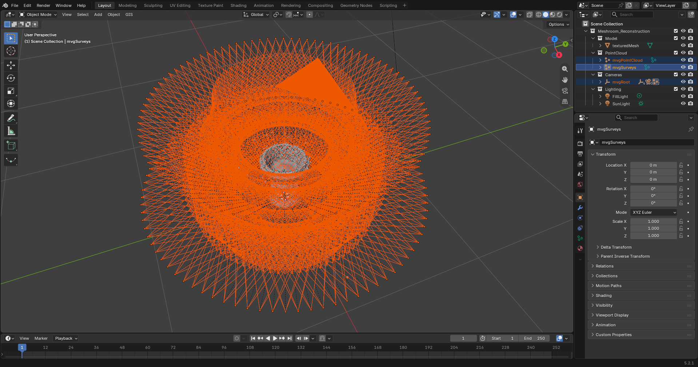
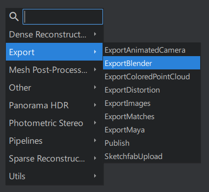
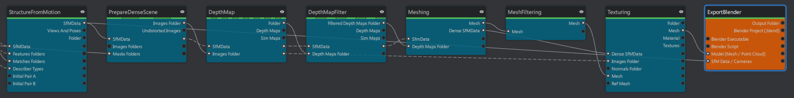

# ExportBlender Plugin for Meshroom

**[English](README.md) | [Bahasa Indonesia](README_ID.md)**

Plugin kustom untuk Meshroom yang mengotomatisasi ekspor seluruh hasil rekonstruksi fotogrametri 3D (geometri mesh OBJ/PLY, material tekstur PBR, point cloud, dan orientasi pose kamera SfM) langsung ke dalam berkas proyek native Blender (`.blend`) siap pakai tanpa memerlukan intervensi manual.

<p align="center">
  
</p>

---

## 1. Spesifikasi Sistem

- **Target Executable Blender**: Blender 3.2+ s/d 5.x+ (otomatis terdeteksi dari PATH, instalasi standar OS, atau dipilih manual lewat GUI).
- **Kompatibilitas Meshroom**: Meshroom 2025.1.0+ (PySide6, AliceVision 2025.1.0)
- **Format Keluaran Utama**: Native Blender Project (`.blend`)
- **Fitur Kunci**:
  - Auto-detection cerdas biner Blender (`blender.exe` / `blender`) dengan dukungan seleksi fleksibel via GUI Meshroom.
  - Auto-import geometri mesh (.obj, .ply, .abc) dengan orientasi sumbu fotogrametri yang selaras (`forward_axis='NEGATIVE_Z'`, `up_axis='Y'`).
  - Auto-import kamera SfM dan sparse point cloud dari Alembic (.abc) atau cameras.sfm (.sfm / .json).
  - Auto-link material PBR (Principled BSDF) beserta pemetaan image texture.
  - Opsi *Pack Textures*: mengemas seluruh file tekstur eksternal langsung ke dalam file `.blend` (sehingga file `.blend` 100% portable dan mandiri).
  - Penataan otomatis outliner Blender berbasis *Collections* (`Meshroom_Reconstruction/Model`, `Cameras`, `PointCloud`, `Lighting`).
  - Setup pencahayaan dasar (Sunlight & Fill Light) dan background environment netral.
  - Opsi *Open in Blender*: membuka proyek `.blend` secara otomatis setelah komputasi selesai secara *asynchronous* (non-blocking).

---

## 2. Struktur Berkas Plugin

```text
ExportBlender/
├── assets/                             # Tangkapan layar dan aset media dokumentasi
│   ├── Adding_ExportBlender.png
│   ├── Graph_Editor_ExportBlender.png
│   └── Result_Blender.png
├── .gitignore                          # Pengabaian cache Python dan artefak sistem operasi
├── LICENSE                             # Berkas lisensi resmi MPL-2.0
├── README.md                           # Dokumentasi publik (Bahasa Inggris)
├── README_ID.md                        # Dokumentasi lokal (Bahasa Indonesia)
└── meshroom/
    ├── config.json                     # Konfigurasi metadata plugin Meshroom
    └── exportBlender/
        ├── __init__.py                 # Inisialisasi package Python
        ├── ExportBlender.py            # Deskriptor Node Meshroom (desc.CommandLineNode)
        └── scripts/
            └── export_to_blend.py      # Skrip pekerja otomatisasi Blender headless (bpy)
```

---

## 3. Parameter Node di Meshroom

### Input Parameters

| Parameter | Tipe | Default | Deskripsi |
|---|---|---|---|
| `blenderExecutable` | File | `(Auto-detected)` | Jalur ke executable Blender. Secara dinamis mendeteksi Blender terbaru di sistem, atau dapat dipilih manual via GUI file browser / diatur via variabel `BLENDER_BIN`. |
| `script` | File | `{nodeSourceCodeFolder}/scripts/export_to_blend.py` | Skrip Python internal yang dijalankan Blender. |
| `model` | File | `""` | Berkas model 3D (sambungkan dari `Texturing.outputMesh` atau `Meshing.output`). |
| `sfmData` | File | `""` | Berkas SfM kamera & sparse cloud (sambungkan dari `StructureFromMotion.output`). |
| `importCameras` | Boolean | `True` | Mengimpor kamera dan pose fotogrametri ke dalam Blender. |
| `packTextures` | Boolean | `True` | Mengemas seluruh tekstur langsung ke dalam file `.blend`. |
| `shadeSmooth` | Boolean | `True` | Menerapkan *smooth shading* pada geometri mesh. |
| `setupLighting` | Boolean | `True` | Menambahkan pencahayaan standar (sunlight & fill light). |
| `openInBlender` | Boolean | `True` | Membuka berkas proyek `.blend` secara otomatis di GUI Blender setelah komputasi selesai. |
| `blendName` | String | `model_reconstruction.blend` | Nama berkas proyek Blender yang dihasilkan. |

### Output Parameters

| Parameter | Tipe | Nilai Default | Deskripsi |
|---|---|---|---|
| `output` | File | `{nodeCacheFolder}` | Direktori cache output Meshroom. |
| `outputBlend` | File | `{nodeCacheFolder}/{blendNameValue}` | Berkas proyek Blender `.blend` yang dihasilkan. |

---

## 4. Panduan Instalasi (Rilis Resmi Meshroom)

Plugin ini kompatibel dengan rilis biner resmi (*pre-built binary release*) **Meshroom 2025.1.0+** (Windows / Linux). Anda dapat memasang plugin menggunakan salah satu dari dua cara berikut:

### Metode 1: Folder `plugins` Bawaan (Direkomendasikan)
Salin atau tempatkan seluruh folder `ExportBlender` langsung ke dalam subdirektori `plugins/` pada instalasi rilis resmi Meshroom Anda.

**Struktur Direktori:**
```text
Meshroom-2025.1.0-Windows/
└── Meshroom-2025.1.0/
    ├── aliceVision/
    ├── meshroom/
    ├── plugins/
    │   ├── ExportBlender/              <-- Tempatkan folder plugin di sini
    │   │   ├── meshroom/
    │   │   │   ├── config.json
    │   │   │   └── exportBlender/
    │   │   │       ├── ExportBlender.py
    │   │   │       └── scripts/
    │   │   └── README.md
    │   └── mrSegmentation/
    └── Meshroom.exe
```

Setelah folder disalin, jalankan `Meshroom.exe`. Node **ExportBlender** akan otomatis terdaftar pada menu node Meshroom.

---

### Metode 2: Melalui Variabel Lingkungan (`MESHROOM_PLUGINS_PATH`)
Jika Anda menyimpan folder `ExportBlender` di lokasi repositori terpisah, Anda dapat mendaftarkannya tanpa memindahkan berkas dengan mengatur variabel lingkungan `MESHROOM_PLUGINS_PATH`:

* **Windows (Command Prompt):**
  ```cmd
  set MESHROOM_PLUGINS_PATH=C:\path\ke\ExportBlender;%MESHROOM_PLUGINS_PATH%
  Meshroom.exe
  ```

* **Windows (PowerShell):**
  ```powershell
  $env:MESHROOM_PLUGINS_PATH = "C:\path\ke\ExportBlender;$env:MESHROOM_PLUGINS_PATH"
  .\Meshroom.exe
  ```

* **Linux (Bash):**
  ```bash
  export MESHROOM_PLUGINS_PATH=/path/ke/ExportBlender:$MESHROOM_PLUGINS_PATH
  ./Meshroom
  ```

---

## 5. Cara Penggunaan di GUI Meshroom

1. Buka Meshroom (`Meshroom.exe` di Windows atau `./Meshroom` di Linux).
2. Pada panel **Graph Editor** (tampilan diagram alur node di bagian bawah):
   - Klik kanan pada area kosong editor.
   - Ketik atau pilih **ExportBlender** (tersedia di bawah kategori `Export`).

<p align="center">
  
</p>

3. Sesuaikan atribut pada panel **Node Attribute Editor** (sisi kanan):
   - Kolom `Blender Executable` telah terisi otomatis dengan biner Blender yang terdeteksi di komputer Anda.
   - Jika ingin menggunakan versi Blender lain, Anda dapat langsung mengetikkan path, menempelkan (*paste*), atau men-drag berkas `blender.exe` langsung ke dalam kolom tersebut.
4. Hubungkan sambungan (Edge Connection):
   - Tarik garis dari pin output `outputMesh` pada node **Texturing** ke pin input `model` pada node **ExportBlender**.
   - Tarik garis dari pin output `output` pada node **StructureFromMotion** ke pin input `sfmData` pada node **ExportBlender**.

<p align="center">
  
</p>
5. Klik kanan pada node **ExportBlender**, lalu pilih **Compute** (atau tekan tombol **Start** pada pipeline).
6. Setelah status node menjadi hijau (`SUCCESS`), berkas `.blend` akan otomatis terbuka di jendela GUI Blender (jika `openInBlender` aktif) serta tersimpan di direktori cache node.

---

## 6. Pengujian Langsung via CLI

Skrip otomasi juga dapat diuji secara mandiri tanpa GUI menggunakan CLI Blender headless:

```cmd
blender -b --python "meshroom/exportBlender/scripts/export_to_blend.py" -- --model "<path_to_mesh.obj>" --sfmData "<path_to_sfm.abc>" --output "<path_to_output_folder>"
```

---

## 7. Lisensi & Penulis

Hak Cipta (c) 2026 Badroe Zaman  
Dilisensikan di bawah [Mozilla Public License Version 2.0 (MPL-2.0)](LICENSE).
